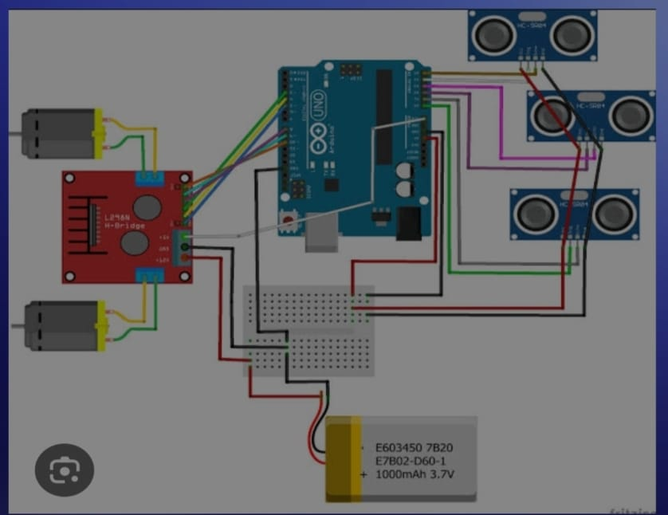
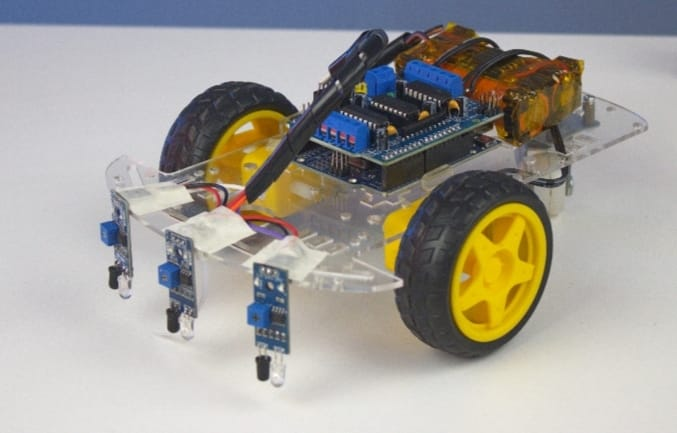

# Maze-solving-robot
TO DESIGN AND IMPELEMNT A ROBOT THAT CAN AUTONOMOUSLY NAVIGATE AND SOLVE A MAZE.
# Maze Solving Robot

## Project Overview
An autonomous robot developed using Arduino UNO that navigates through a maze by detecting obstacles and selecting a direction based on available space.

## Hardware Components
- Arduino UNO
- 3 HC-SR04 Ultrasonic Sensors
- L298N Motor Driver
- 2 DC Motors
- Two-Wheel Robot Chassis
- Rechargeable Battery
- Breadboard and Jumper Wires

## Technologies Used
- Arduino UNO
- Embedded C/C++
- Arduino IDE
- Ultrasonic Distance Measurement
- Motor Control

## Working Principle
1. Ultrasonic sensors measure distances in front, left and right directions.
2. Arduino UNO processes the sensor readings.
3. The robot moves forward when the front path is clear.
4. When an obstacle is detected, it compares left and right distances.
5. The robot turns toward the side with more available space.

## Motor and Sensor Connections

| Component | Arduino Pins |
|---|---|
| Front sensor TRIG | 9 |
| Front sensor ECHO | 8 |
| Right sensor TRIG | 3 |
| Right sensor ECHO | 2 |
| Left sensor TRIG | 5 |
| Left sensor ECHO | 6 |
| Motor 1 | 10, 11 |
| Motor 2 | 12, 13 |
| ENA | 7 |
| ENB | 4 |
## Circuit Diagram

## Source Code
See `code/maze_solver.ino`.

## Project Status
Arduino program uploaded. Hardware testing and calibration required.
 ## Key Features
- Obstacle detection using three ultrasonic sensors.
- Automatic forward movement when the path is clear.
- Left and right distance comparison.
- Automatic turning toward the side with more available space.
- Motor control using the L298N driver.
 ## Limitations
- The robot uses basic wall-following decision logic.
- Turning time may require calibration based on motor speed.
- Sensor readings can vary depending on obstacle surfaces and distance.
- Hardware testing is required for reliable navigation.
## Installation and Setup

1. Install Arduino IDE.
2. Connect Arduino UNO to your computer using a USB cable.
3. Open `code/maze_solver.ino` in Arduino IDE.
4. Select Arduino UNO under Tools → Board.
5. Select the correct COM port.
6. Upload the program to Arduino UNO.
7. Connect the sensors and motor driver according to the circuit diagram.

## Future Improvements
- Implement more advanced maze-solving algorithms.
- Add path memory and optimization.
- Improve turning accuracy using motor calibration.
  ##Project Demo
  
